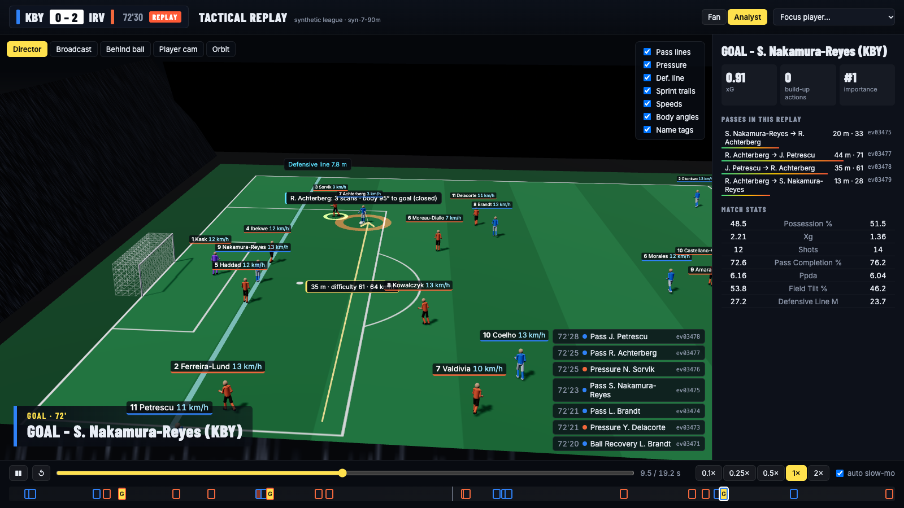
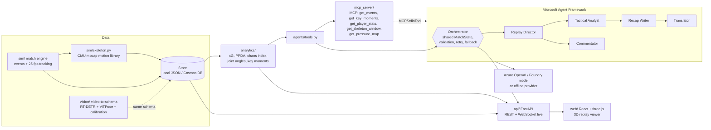

# 3D Tactical Replay

**Broadcast-style 3D replays of every key moment, explained by a team of AI agents.**
Built for the Microsoft x Premier League *Inside the Game* hackathon (category: Best Multi-Agent System).



Modern football video games replay goals from any angle. We do that for analysis: every
goal, big chance and save is rebuilt in 3D from tracking and skeleton data, with broadcast,
behind-the-ball, player-cam and orbit cameras, slow motion and scrubbing, and overlays for
pass lines and pass difficulty, pressure, the defensive line, sprint trails, speeds and
body angles (knee and hip at the strike, trunk lean, scanning before receiving). A
multi-agent system explains why each moment mattered, with every claim tied to event ids,
for an analyst or for a casual fan, in four languages.

All match data is **synthetic** (fictional clubs, fictional players), generated by our own
seeded match engine. Body motion comes from real motion capture (CMU mocap database).

## What it does

| Pipeline step | How |
|---|---|
| **Ingest** | Seeded 25 fps match engine emits events (pass, carry, shot, goal, save, tackle, interception, pressure, foul, restarts, possession changes), tracking and 3D skeletons. The API streams it "live" over WebSocket at any speed. |
| **Interpret** | `analytics/`: geometric xG, pass difficulty from tracking (pressure, lane, receiver space), progressive passes, possession, PPDA, field tilt, defensive line height, sprints and distance, control-vs-chaos index, pressure maps, joint angles, scanning, key-moment ranking. |
| **Explain** | Five Microsoft Agent Framework agents (Replay Director, Tactical Analyst, Commentator, Recap Writer, Translator) over a shared match state; every claim must cite real event ids. |
| **Render** | React + three.js viewer: scorebug, live ticker, key-moment timeline, 3D replay with timed, machine-readable overlays and agent captions. |
| **Personalise** | Analyst vs Fan modes (different agent output, overlays and stats), favourite-player focus (ring, player cam, focus paragraph in the recap), English/Spanish/French/Portuguese. |

## Architecture



### Agents and handoffs

The pipeline is a Microsoft Agent Framework **workflow graph** (`agents/workflow.py`,
`WorkflowBuilder` + `Executor`s): `replay_director` fans out one message per key moment to
`moment_analysis`, which fans in to `recap_writer`, which hands off to `translator`, which
yields the workflow output. Agents share one `MatchState` blackboard.

1. **Replay Director** reads the ranked key moments and picks the reel: which moments, which
   camera at which time (broadcast -> behind the ball -> player cam on the shooter), and
   where to slow down. The viewer's *Director* camera follows this script.
2. **Tactical Analyst** and **Commentator** run in parallel for each moment, from a context
   built by the match tools (build-up chain, pass metrics, strike biomechanics, scanning,
   pressure, game-rhythm phase).
3. **Recap Writer** reads the analysts' findings from the shared state plus match metrics.
4. **Translator** renders everything in the requested language.

Every reply must be JSON in a fixed contract, and every sentence must cite event ids that
exist in the match. A rejected reply is retried once with the validation error; if it fails
again, the deterministic offline agent answers instead. Every step lands in a trace, shown
in the *Agents* tab. Without Azure credentials the whole system runs on the offline
provider (templates in four languages), so the app and the tests work with no cloud
access.

## Quickstart

```bash
# backend (Python 3.11+)
uv venv && uv pip install -e ".[dev]"          # or: python -m venv .venv && pip install -e ".[dev]"
python -m sim --seed 7 --minutes 90             # optional: the API generates seed 7 on first start
uvicorn api.main:app --port 8000

# frontend
cd web && npm install && npm run dev            # http://localhost:5173 (proxies /api to :8000)
# or build once and let the API serve it: npm run build -> http://localhost:8000

# everything in Docker
docker compose up --build                       # viewer + API on :8000, MCP server on :8001/mcp

# tests and lint
pytest -q && ruff check .
```

Enable the LLM agents by copying `.env.example` to `.env` and setting
`AZURE_OPENAI_ENDPOINT` and `AZURE_OPENAI_DEPLOYMENT` (API key or Entra ID).

### API

| Endpoint | |
|---|---|
| `GET /api/matches`, `POST /api/matches/generate {seed, minutes}` | list / create matches |
| `GET /api/matches/{id}` | metadata, rosters, replay windows |
| `GET /api/matches/{id}/events?start_t&end_t&types` | event stream |
| `GET /api/matches/{id}/key-moments`, `/metrics`, `/players/{pid}` | analytics |
| `GET /api/matches/{id}/replay/{window}` | 25 fps tracking + skeletons + overlay annotations |
| `GET /api/matches/{id}/insights?mode=fan\|analyst&lang=en\|es\|fr\|pt&focus=pid` | agent outputs + trace |
| `WS /api/matches/{id}/live?speed=10` | simulated live feed: events + 2 fps positions |

### MCP server

`python -m mcp_server` (stdio) or `python -m mcp_server --http 8001` (Streamable HTTP at
`/mcp`). Tools: `list_matches`, `get_match_summary`, `get_events`, `get_key_moments`,
`get_player_stats`, `get_skeleton_window`, `get_pressure_map`. Model-backed agents use it
through Agent Framework's `MCPStdioTool`; GitHub Copilot agent mode or any MCP client can
connect to the same server.

## Microsoft technology

| Technology | Where |
|---|---|
| **Microsoft Agent Framework** | `agents/`: the pipeline is a `WorkflowBuilder` graph of `Executor`s (fan-out per moment, fan-in to the recap); every agent is an `agent_framework.Agent`; the offline provider is a custom `BaseChatClient`; MCP tools via `MCPStdioTool`. |
| **Microsoft Foundry / Azure OpenAI** | `agents/providers.py`: `OpenAIChatCompletionClient` against an Azure OpenAI (Foundry) deployment, key or Entra ID auth. `infra/` deploys the model. |
| **MCP** | `mcp_server/`: official `mcp` SDK server, stdio + Streamable HTTP. |
| **Azure Cosmos DB** | `api/store.py` `CosmosStore` (`STORE=cosmos`), serverless account + RBAC in `infra/main.bicep`. |
| **Azure Container Apps** | `Dockerfile`, `azure.yaml` (`azd up`), `infra/main.bicep` (ACR, managed identity, Log Analytics). |
| **GitHub Actions / Copilot** | `.github/workflows/ci.yml` (ruff, pytest, web build, Docker build). |

## Data

The schema in `sim/schema.py` (JSON Schemas in `docs/schema/`) is source-agnostic: the
synthetic engine and the video pipeline produce the same `Match`, `Event`,
`TrackingWindow`, `SkeletonWindow` and `LowResTracking` documents.

- **Pitch** 105 x 68 m, `x` along the length, `y` across, `z` up, `t` seconds since kick-off.
- **Events** carry stable ids (`ev00042`) that agents cite as evidence.
- **Tracking**: 25 fps windows around every shot, plus whole-match tracking at 2 fps.
- **Skeletons**: 17 joints per player per frame, with optional per-joint confidence
  (set by pose models, empty for synthetic data).

### Synthetic match engine (`sim/`)

A continuous, seeded, agent-based simulation at 25 fps: formations (4-3-3 vs 4-4-2) that
shift with the ball, an offside-aware attacking line, pressing with a team intensity,
marking, and a utility model for the ball carrier (pass, through ball, dribble, shot,
clearance). Pass success depends on distance, lane clearance, receiver space and
pressure; tackles and fouls depend on attributes. Events emerge from the continuous
state, so events, tracking and skeletons always agree. `python -m sim --seed N`.

### Motion capture (`sim/mocap/`)

Players are animated with real human motion: walk/jog/run cycles, a defensive
side-shuffle, six real soccer kicks, standing idle and a sideways jump (keeper dive base)
from the CMU Graphics Lab Motion Capture Database, retargeted to the 17-joint schema
(`python -m sim.mocap.build_library` rebuilds `library.npz` from the source files).
Cycles are blended by speed with cadence matched to ground speed, so feet do not slide;
kicks are aligned to the moment of ball contact; bones are kept rigid. `tests/test_skeleton.py`
checks planted feet, rigid bones, human joint limits and frame-to-frame continuity.

> The data used in this project was obtained from mocap.cs.cmu.edu.
> The database was created with funding from NSF EIA-0196217.

Not in the CMU set, so still procedural: the slide-tackle pose and the keeper's dive roll.

### Synthetic vs real data

Synthetic skeletons feed **only** the simulation, the replay and the demo. The
video-to-skeleton module (`vision/`) is built and validated on real video, never trained
on synthetic skeletons. Real footage, frames and anything derived from it per player stay
out of this repository.

## Video-to-schema module (`vision/`)

`pip install -e ".[vision]"`. Turns a fixed wide-angle panorama recording into the same
schema the viewer replays (25 fps positions, events, 3D skeletons), so a real clip plays
back in the 3D viewer and goes through the same analytics and agents as a synthetic match:

```bash
python -m vision.fetch <video url> <start_s> 60 cache/clip.mp4            # cache a 60 s segment (stream copy)
python -m vision.calibrate landmarks.json frame.jpg cam.json               # once per venue
python -m vision.extract cache/clip.mp4 cam.json <start_s> 60 cache/ex.npz # people + 2D pose
python -m vision.ball cache/clip.mp4 cam.json followcam.json dirs.det cache/ex.npz cache/ball.npz
python -m vision.assemble cache/ex.npz cam.json cache/matches --ball cache/ball.npz --motion lift
DATA_DIR=cache/matches AUTOGENERATE=0 uvicorn api.main:app --port 8010
```

1. `vision.calibrate`: fits a camera model (shared position, per-half equirectangular or
   fisheye projection, pitch length/width) to a few manual landmarks (corners, goal posts,
   halfway line, points along touchlines). Residuals are in pixels, so scale cannot collapse.
2. `vision.extract`: RT-DETR person detection (Apache-2.0, Hugging Face) on each half,
   ground positions through the calibration, torso colours, ViTPose 2D pose (Apache-2.0).
3. `vision.ball`: the ball is 4-8 px. Candidates come from an RT-DETR pass on a
   full-resolution crop around the recording's follow-cam direction (a coarse prior fit by
   RANSAC) and from static-camera motion blobs; selection is gated by how far a ball can move.
4. `vision.assemble`: ground-plane tracking (constant velocity + Hungarian assignment, so
   tracks continue across the panorama seam), team split by torso colour, 25 fps
   resampling, 3D skeletons, and a match folder in the `sim` layout. Skeletons are either
   the observed pose (`--motion lift`: single-view lift with rigid bones and depth recovered
   by Taylor's method) or CMU mocap placed on the real tracks (`--motion mocap`); the viewer
   header says which.
5. `vision.events`: control runs -> passes, possession changes, shots and goals from tracks
   and ball. The same code runs on synthetic windows, where the engine's events are ground
   truth: pass precision 0.93 / recall 0.82, 26 of 30 shots found (seed 7).

Ultralytics/YOLO was avoided because it is AGPL-3.0; everything here is Apache-2.0/MIT/BSD.
Real footage, frames, outputs and calibration files stay outside this repository
(a git-ignored local cache); only aggregate, anonymous numbers are reported here.

## Repository layout

```
sim/          engine, schema, mocap-driven skeletons, CLI
analytics/    metrics, biomechanics, key moments
agents/       orchestrator, offline provider, model provider, match tools
mcp_server/   MCP server
api/          FastAPI app and storage (local JSON, Cosmos DB)
vision/       video-to-schema pipeline (calibration, detection, pose, tracking)
web/          React + three.js viewer
infra/        Bicep for Azure Container Apps, Azure OpenAI, Cosmos DB (azd)
tests/        pytest: sim, skeletons, analytics, agents, API, MCP
```

## Legal

Clubs, players and the league are fictional. No real club names, badges, player names
or game-franchise assets are used. Dependencies are permissively licensed (MIT, BSD,
Apache-2.0). Motion data: CMU Graphics Lab Motion Capture Database (free for any use,
attribution above).
